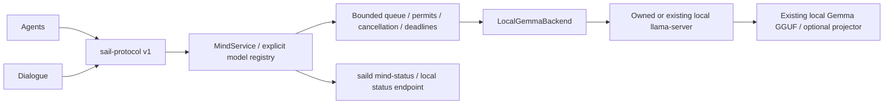

# SAIL Mind: local inference and model routing

Mind is the Rust owner of model startup, routing, inference capacity, cancellation,
capability detection and measurements. Its `MindService` is shared by Agents and
all Dialogue sessions. Speech workers remain separate existing adapters; this
change does not migrate the voice stack's Python speech engines (issue #1).



## Running the daemon

Run from the repository root with existing weights and a compatible llama-server:

```bash
cargo run -p sail-core --bin saild
# The historical executable remains supported:
cargo run -p sail-core
```

The default Gemma file is `models/gemma4-v2-Q4_K_M.gguf`, with the optional projector
at `models/voice/mmproj-gemma-4-12B-it-Q8_0.gguf`. Nothing downloads or promotes a
model at runtime. Default native model execution binds `127.0.0.1:8081`. The normal
Dialogue HTTP/HTTPS listener exposes the UI and read-only `/api/mind/status`.
Existing LAN TLS requirements still apply.

Model loading is asynchronous: the daemon/UI can report `starting` instead of
waiting for the entire load. A Mind-ready event is emitted only after health and
capability probes succeed. Missing weights or an unsupported runtime leave Mind
`unavailable` while other runtime services remain usable. A later request retries
availability; partial generated responses are never automatically replayed.

```bash
# Read the RUNNING daemon's model status and metrics, without launching a model.
cargo run -p sail-core --bin saild -- mind-status
```

The command queries loopback `/api/mind/status`, using port 8088 or the port in
`SAIL_VOICE_BIND`. If `SAIL_TLS_CERT` is set it uses HTTPS and trusts that certificate.
`SAIL_MIND_STATUS_URL` can select another loopback status URL with exactly that
path. It does not create a fresh service and present fabricated zero counters.
If the daemon cannot be reached, the command fails clearly.

## Explicit local configuration

| Variable | Behavior |
|---|---|
| `SAIL_MODEL_PATH` | Explicit existing GGUF path |
| `SAIL_LLAMA_SERVER` | Native llama-server binary; default `/home/main/llama.cpp/build/bin/llama-server` |
| `SAIL_MMPROJ` | Optional existing projector path; runtime capability is still checked |
| `SAIL_MODEL_THREADS` | Explicit CPU thread budget; must fit available logical CPUs |
| `SAIL_MODEL_BACKEND` | `cpu` (default) or `vulkan` |
| `SAIL_VULKAN_DEVICE` | Native device name, default `Vulkan0` |
| `SAIL_GPU_LAYERS` | Explicit Vulkan layer budget, default 8, maximum 128 |
| `SAIL_LLM_URL` | Existing loopback `/v1/chat/completions`; setting this selects external-process ownership |

Default managed CPU execution explicitly passes `--device none --gpu-layers 0`,
rather than relying on a native runtime's automatic GPU selection. Threads default
to at most six and the model context to 8192 tokens. The default queue admits one
active inference and eight pending requests, preventing concurrent agents and
voice sessions from each assuming the entire CPU belongs to them.

For a Vulkan build on a host with the RX5500 available:

```bash
SAIL_MODEL_BACKEND=vulkan SAIL_VULKAN_DEVICE=Vulkan0 SAIL_GPU_LAYERS=8 \
SAIL_LLAMA_SERVER=/absolute/path/to/vulkan-enabled/llama-server \
cargo run -p sail-core --bin saild
```

Before starting an owned Vulkan process, Mind checks `--list-devices` for the exact
requested device. It passes the requested device/layer budget and never silently
falls back to CPU. A Vulkan launch path does not establish RX5500 throughput or
VRAM headroom: choose layers/context for the actual machine and measure it. This
implementation environment exposes OpenBLAS only; real GPU execution has not been
validated here.

An existing local service can be used with:

```bash
SAIL_LLM_URL=http://127.0.0.1:8080/v1/chat/completions \
cargo run -p sail-core --bin saild
```

External mode never starts or kills that model process. Its CPU/GPU placement and
thread budgets must be configured by its owner. Status reports `owned_process:
false` and `observed_backend: null` rather than pretending the external server's
compute device was measured. An owned process reports its selected backend/PID,
is reaped after shutdown, and can be restarted after a crash. Loading deadlines
also clean up only owned processes.

## Contracts, routing and budgets

See [Inference v1](../PROTOCOL/Inference_V1.md) and its JSON Schema for the full
request/event/response/error contracts. Models/aliases are explicitly registered;
unknown or ambiguous names are rejected. No automatic model substitution occurs.
The built-in names are `gemma4`, `gemma-4`, `local`, and the configured model path.
Embedders may register additional explicit Rust `InferenceBackend` adapters.

Capability detection comes from local runtime `/health` and `/props`: vision must
be affirmatively advertised; tools require declared support or a tool-aware chat
template. File names and projector existence are not capability evidence. When the runtime reports its GGUF path, a different basename is rejected rather than silently reusing the wrong model. The status model key identifies the registry entry; capability metadata identifies the reported loaded GGUF when available. Requests
for unavailable vision/tools fail before generation. Context budgets use local
`/apply-template` and `/tokenize`, output headroom and a conservative image reserve.
These endpoints must be available in the selected llama-server build.

Input/response bytes, image sizes/count/dimensions, output tokens, tool counts,
queue size and deadlines are bounded. `ResourceLimits` is supplied to
`MindService::new` or `with_backends`; default values are exposed in status.
A cancellation token cancels queueing, model probes and stream I/O. Explicit
`MindService::cancel(request_id)` cancels that registered request only. Dropping a
caller's future also releases its registry entry and permit. Shutdown stops new
admissions and cancels pending/active requests plus background startup.

## Validation and examples

```bash
cargo test --workspace
cargo clippy --workspace --all-targets -- -D warnings

# Actual text inference; uses the local managed model unless SAIL_LLM_URL is set.
cargo run -p sail-mind --example local_inference

# Actual image inference, requiring the running model's vision capability.
SAIL_MIND_IMAGE=/absolute/path/to/image.png \
cargo run -p sail-mind --example local_inference
```

The example prints streamed text, the versioned response/usage/timings and its
service's real metrics, then shuts down only the model it owns. It needs no Python
speech runtime or hosted model account.

Tests cover fragmented UTF-8/SSE, tools, vision denial, remote-endpoint/image
rejection, context/input/output limits, bounded queues, queued/active cancellation,
dropped callers, duplicate IDs, deadlines, explicit routing, model crashes/restarts,
load timeout, missing Vulkan devices and preservation of external processes. The
managed-process tests supervise a Rust test server through an executable shim;
they are lifecycle fixtures, not assertions about neural inference quality. One
ignored helper is invoked by those tests as a child process.
