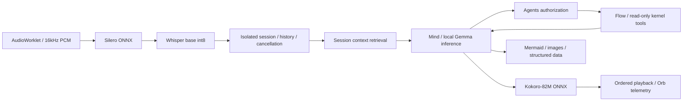

# Local voice pipeline



## Ownership and model execution

Dialogue coordinates each WebSocket session. Mind owns the shared `VoiceModelServices` registry, with a persistent process per engine (VAD, STT, TTS). Keeping the engines separate lets microphone/VAD traffic continue while Whisper or Kokoro is busy. The Rust coordinator communicates with workers over stdin/stdout NDJSON, with no listening speech ports. Workers use local model paths and offline Hugging Face mode. An eight-request limit per engine bounds pending work. Each request has a 120-second deadline; failed workers are killed and restarted on the next request. Cancellation drains an outstanding worker response before admitting the next request, preventing protocol desynchronization.

Gemma runs through a local `llama-server`, managed by Mind on loopback port 8081 with an 8192-token context. The model file is `models/gemma4-v2-Q4_K_M.gguf`. A Gemma 4 12B Q8 projector enables image reasoning. An existing local model service can be selected via `SAIL_LLM_URL`; voice inference rejects non-loopback endpoints. `GET /api/health` loads the speech workers and reports actual readiness plus model modalities.

Implemented defaults:

| Channel | Engine / behavior |
|---|---|
| `voice:vad` | Actual Silero ONNX inference, 512 samples at 16kHz; confidence and hysteresis |
| `voice:stt` | Actual Whisper base multilingual, CTranslate2 CPU int8; windowed partial word tokens and final decoding |
| `voice:vlm` | Streamed local Gemma chat with text/image input and bounded tool-call rounds |
| `voice:tts` | Actual Kokoro-82M ONNX; sentence fragments, 24kHz PCM, ordered 100ms WAV packets |
| `voice:orb` | RMS, phase, Hann-windowed FFT into eight frequency bands, speaker/turn and measured timing |
| `voice:control` | Input mute, hardware thread budgets, manual end-turn, reset, interruption and automatic barge-in |

Qwen3-ASR and Qwen3-TTS are alternative engines described in the feature request, not adapters implemented by this version. The selected Whisper/Kokoro path is fully local and avoids pretending acoustic heuristics are trained models.

## Session and turn behavior

Each connection has a UUID, separate VAD recurrent state, audio buffer, control state and bounded history. Context is limited to six conversation pairs and a 24KB history budget; the oldest pairs are also removed before inference to keep text and image reservations within a 20KB prompt budget (an individual pair can reach the 16KB input limit). Arena retrieves relevant records only from the same session; its voice records are bounded and removed on reset/disconnect. This voice history is memory-only and does not survive a runtime restart.

Browser hardware audio is resampled in an AudioWorklet to signed little-endian 16-bit mono PCM at 16kHz. The resampler carries phase between callbacks and emits exact 512-sample frames. Silero uses 128ms minimum speech, 350ms silence, 96ms pre-roll and hysteresis. A tentative onset interrupted by silence is discarded. Utterances are bounded to 30 seconds. Sub-3ms inference is a target measured in telemetry, not an unconditional timing guarantee.

A separate turn task performs final STT, retrieves context, streams Gemma deltas, handles authorized tool calls, synthesizes sentence fragments and publishes Canvas artifacts. The socket continues processing controls and microphone audio. Each turn has a generation number. Manual interruption, a new text turn, reset or detected user speech aborts the old task; stale outgoing deltas and audio are discarded. The browser stops active and scheduled audio and drops pending decodes. Speech workers may finish the current inference internally, but its cancelled response is not played.

Whisper emits revisable partial transcripts roughly every 0.8–2 seconds depending on tier. These are full hypotheses, not guaranteed monotonic token deltas. Silence produces no fabricated transcript. Errors in STT, LLM or TTS are visible to the client. Failed LLM inference produces no canned assistant response.

## Knowledge, actions and visual output

Arena scores relevant session records by shared query terms. Agents allow only the named read-only voice capabilities. Flow executes these authorized operations synchronously through the local broker. `fs:query` canonicalizes paths against `SAIL_TOOL_ROOT` (default current workspace) and rejects traversal and symlink escapes. `proc:list` is limited to 100 results. `vision:frame` validates dimensions, channel format, pixel length and a 4MB limit; it computes real luminance and edge-density statistics. Uploaded PNG/JPEG input goes separately to Gemma for semantic vision reasoning.

Local tool definitions are sent to Gemma as function schemas. Returned calls pass through the same Agents/Flow path as explicit UI tool buttons, and their results feed the model's next response. There are at most three tool rounds and eight calls per response, followed by a final answer with `tool_choice: none`. Capability-list questions disable tool execution from the start. A failed/denied tool or a repeated normalized request ends tool use early; duplicate observations are reused without executing or publishing another tool card. The final prose request strips native tool-call messages and supplies observations as plain data. A streaming gate retains possible split control-token prefixes before text reaches the browser or speech queue, while ordinary prose streams immediately. Malformed control-token output or tool requests in the final pass discard pending unspoken text and append a grounded runtime status with no further execution. Already committed safe prose cannot be withdrawn. Such deltas identify `source: runtime_tool_summary`. Voice does not invoke arbitrary shell commands or external connectors.

Canvas extracts fenced Mermaid and JSON blocks from the response. The browser shows structured results, safely inserts plain text, renders diagrams using a locally bundled Mermaid in strict mode, and displays uploaded images. No CDN or external network request is needed at runtime. Voice publishes Canvas bus events for other subsystem consumers without sending the prompt through a second inference path.

## Protocol

Connect to `/ws/voice` on the UI origin. Browser Origin must match Host; clients without an Origin header are accepted for native use. The connection starts with a `session` message declaring input format and controls.

Binary messages contain 16kHz mono PCM16LE (at most 8192 bytes; even byte count). JSON controls:

```json
{"action":"text","text":"Check memory usage"}
{"action":"text","text":"Describe this image","vision":{"format":"image/png","data_base64":"..."}}
{"action":"toggle_mute"}
{"action":"set_tier","profile":"LowPower"}
{"action":"set_voice","voice":"pf_dora"}
{"action":"interrupt"}
{"action":"end_turn"}
{"action":"reset"}
{"action":"playback_finished"}
{"action":"kernel_tool","tool":"fs:query","params":{"path":"."}}
```

Profiles: `LowPower` (2 threads, ~2s partial cadence), `Balanced` (4 threads, ~1s cadence), `HighPerformance` (8 threads, ~0.77s cadence). Transport and Silero remain 16kHz/512 samples for every tier. Tier changes reload the STT/TTS session with the new thread budget on the next inference. Supported UI voices: `af_heart`, `pf_dora`, `pm_alex`, `ef_dora`; `am_michael` is also accepted by the protocol.

Server messages: `session`, `control`, `telemetry`, `transcript` (word tokens, confidences, audio timestamps, final flag), `turn_started`, `response_delta`, `response_finished`, `tool_result`, `audio_chunk`, `canvas`, `interruption`, `turn_finished`, `error`. Telemetry reports model inference time and VAD worker round trip separately. `audio_chunk` contains base64 WAV, actual sample rate and output telemetry. The browser schedules packets on a single AudioContext timeline. Turn completion and playback completion are separate events.

At 16kHz, frequencies above the 8kHz Nyquist limit have no measured energy; the 12–20kHz “air” band is zero. The same eight-band analyzer uses the actual TTS sample rate for output. No synthetic per-band energy or fixed latency values are advertised.

## Setup and secure microphone access

Run `scripts/voice/setup.sh` using Python 3.11 (`SAIL_SETUP_PYTHON` overrides the interpreter). This creates `.venv-voice`, installs pinned dependencies and downloads the model files. Downloads use pinned Silero, Whisper and Gemma revisions, plus the versioned Kokoro v1.0 release. A manifest records SHA-256 values for downloaded standalone models. Model weights and the virtual environment are ignored by Git. Runtime workers never download missing weights.

The existing workspace has a working `.venv-voice` and downloaded models. Run `cargo run -p sail-core` from the repository root and open `http://localhost:8088` on the same computer. The default `llama-server` binary path is `/home/main/llama.cpp/build/bin/llama-server`; override it for other installations.

For LAN access, generate a certificate with `scripts/voice/tls.sh 192.168.1.101`, trust the generated public certificate on each client, and start with `SAIL_VOICE_BIND=0.0.0.0:8088`, `SAIL_TLS_CERT=.local/tls/voice-cert.pem`, and `SAIL_TLS_KEY=.local/tls/voice-key.pem`. A certificate from an already trusted local CA is also supported. Merely bypassing a certificate warning may not establish a secure microphone context. The runtime refuses non-loopback HTTP bindings; the UI also detects insecure contexts and explains how to fix them. HTTPS does not add user authentication; only expose the listener on a trusted network.

| Variable | Purpose |
|---|---|
| `SAIL_VOICE_BIND` | UI listen address; default `127.0.0.1:8088` |
| `SAIL_TLS_CERT`, `SAIL_TLS_KEY` | PEM certificate and key for HTTPS |
| `SAIL_VOICE_PYTHON` | Worker interpreter; default `.venv-voice/bin/python` |
| `SAIL_VOICE_WORKER` | Worker script; default `scripts/voice/worker.py` |
| `SAIL_VOICE_MODELS` | Model directory; default `models/voice` |
| `SAIL_LLAMA_SERVER` | Local llama-server binary |
| `SAIL_LLM_URL` | Local chat completions endpoint; default `http://127.0.0.1:8081/v1/chat/completions` |
| `SAIL_MMPROJ` | Local Gemma vision projector path |
| `SAIL_TOOL_ROOT` | Authorized filesystem inspection root |
| `SAIL_TTS_VOICE`, `SAIL_TTS_LANGUAGE` | Default voice/language, e.g. `pf_dora` / `pt-br` |

## Validation and model sources

`cargo test --workspace` verifies turn boundaries, onset preservation, forced end/length bounds, true spectral separation, tool validation and scope, Arena session isolation, Canvas extraction and subsystem event integration. The subsystem test injects a clearly identified local mock LLM rather than depending on fake production fallbacks.

`scripts/voice/smoke.py` executes actual offline Kokoro → Silero → Whisper inference and writes `.local/voice-smoke.wav`. `scripts/voice/e2e.py PORT` exercises a running server with text, PCM, vision, isolated sessions, restricted tools and cancellation. `scripts/voice/browser_test.py PORT` covers microphone start/restart/cleanup, tool cards, Mermaid, escaped text and insecure-context handling with Chromium. Optional test dependencies are in `scripts/voice/requirements-test.txt`.

Primary implementations and models: [Silero](https://github.com/snakers4/silero-vad), [faster-whisper](https://github.com/SYSTRAN/faster-whisper), [Whisper base weights](https://huggingface.co/Systran/faster-whisper-base), [Kokoro-82M](https://huggingface.co/hexgrad/Kokoro-82M), [Kokoro ONNX runtime and conversion](https://github.com/thewh1teagle/kokoro-onnx), [Gemma 4 12B projector](https://huggingface.co/ggml-org/gemma-4-12B-it-GGUF), [llama.cpp multimodal serving](https://github.com/ggml-org/llama.cpp/blob/master/docs/multimodal.md), [browser microphone secure-context requirement](https://developer.mozilla.org/en-US/docs/Web/API/MediaDevices/getUserMedia).

## Runner diagnostics

The executable defaults to DEBUG for SAIL modules, printing readable events to stderr and appending them to `.local/runner.log`. Session and turn spans correlate socket commands, microphone/VAD transitions, Arena retrieval, model requests, tool calls and results, TTS fragments and Canvas delivery. Worker load/reload output and SAIL-owned llama-server stdout/stderr are forwarded through tracing; native model output is also retained in `.local/llama-server.log`. `RUST_LOG` overrides the default filter. TRACE on `sail_dialogue` and `sail_mind` adds per-frame and per-token events. Request/result summaries bound text length and omit audio/image payloads. See [USAGE.md](../../USAGE.md#follow-what-the-runner-is-doing) for commands.

## Early speech and prosody

A per-round `SpeechTextGate` filters split model control markers without buffering an entire no-tools answer. `SpeechChunker` scans all received text, rather than only checking the last character of a model delta. It commits complete sentences (including punctuation/closing quotes), excludes common abbreviation/decimal boundaries, and uses clause punctuation for long sentences. Unpunctuated text exceeding 360 characters can be bounded at a complete word. This favors sentence context over token-by-token synthesis.

The speech consumer runs concurrently with model generation. Kokoro is pre-warmed when a session connects; each committed unit is synthesized at the selected voice/speed, streamed in ordered 100ms packets, and followed by a short punctuation-aware silence because Kokoro trims its output. This preserves local sentence/question intonation and phrase cadence, while independent synthesis cannot guarantee the same global prosody as a full-paragraph pass.

`response_finished` marks text/model completion independently of the remaining TTS queue. `turn_finished.first_audio_ms` records the time from turn processing to first synthesized audio readiness, and the logs report it before normal total-turn completion. It is a server readiness measurement, not browser audio-device latency. A regression model deliberately waits for the speech consumer to receive its first sentence before producing its final text, verifying causal overlap on both tool-enabled and tool-disabled answer paths.
