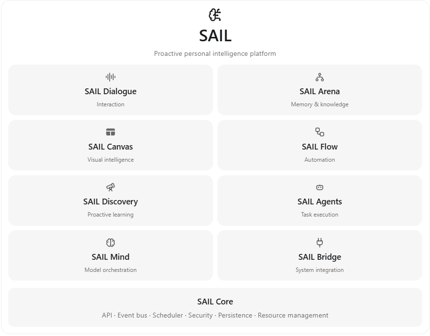
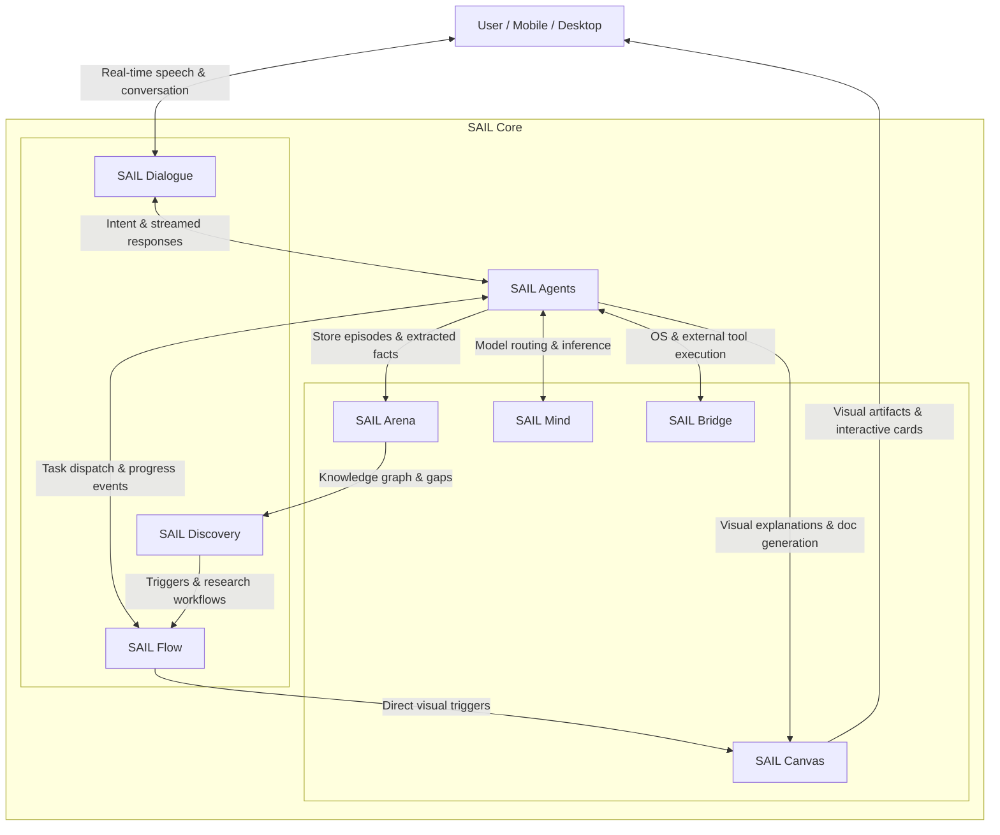

# SAIL

Local-first proactive AI assistant runtime, inference orchestration, persistent memory, autonomous research, and distributed computing.

Start with the [usage guide](USAGE.md) for the recommended local voice workflow, controls, examples and optional LAN access.



## Core Architecture & Subsystem Interactions

SAIL Core operates around an event-driven coordination model connecting user interfaces, autonomous discovery, agent planning, and local neural intelligence.



## What each subsystem owns

- **SAIL Dialogue**: Real-time speech, conversation turns, interruption handling, streaming transcripts, and the voice Orb. Uses **Silero ONNX**, **Whisper base (CTranslate2, int8)** and **Kokoro-82M ONNX** through offline workers managed by Mind.
- **SAIL Arena**: Persistent associative knowledge graph, episodic memory, research collections, and semantic relationships.
- **SAIL Canvas**: Text-to-visual documents, diagrams, interactive boards, and visual explanations rendered directly to the user.
- **SAIL Flow**: Workflow orchestration, triggers, automation nodes, condition evaluation, and execution scheduling.
- **SAIL Discovery**: Autonomous curiosity engine, learning resources, knowledge-gap identification, and proactive interest exploration.
- **SAIL Agents**: Goal decomposition, specialized worker delegation, tool proposal & authorization, step verification, and task coordination.
- **SAIL Mind**: Local Gemma 4 (`models/gemma4-v2-Q4_K_M.gguf` via `llama-server`), native SSM/MoE models, inference adapters, context window allocation, and compute routing.
- **SAIL Guardian**: Access control, capability grants (`devices`, `files`, `system`, `tools`), sandbox policy, interactive user approvals, and tamper-evident SHA-256 audit receipts.
- **SAIL Bridge**: Host OS integration, sandboxed command execution, browser/application connectors, and peripheral communication.

## Local Voice Pipeline

`16kHz PCM → Silero → Whisper → Session → Gemma → Kokoro → Orb`

The Rust runtime owns sessions, turn detection, interruption, streaming, authorization and telemetry. Persistent local Python workers run the actual speech models; no cloud inference APIs are used. Arena retrieves session context, Agents authorize read-only tools, Flow executes them, and Canvas presents Mermaid diagrams, images and structured data alongside the conversation.

The speech models and Gemma 4 12B vision projector are downloaded to `models/voice/`. The existing Gemma weights stay in `models/gemma4-v2-Q4_K_M.gguf`.

```bash
# First-time setup requires Python 3.11 and internet for package/model downloads.
# This workspace already has .venv-voice and the downloaded models.
./scripts/voice/setup.sh
cargo run -p sail-core
```

Open **http://localhost:8088** on the server computer. The managed Gemma service uses **127.0.0.1:8081**; `SAIL_LLAMA_SERVER` overrides its binary path. `SAIL_LLM_URL` can select an existing local OpenAI-compatible server, which must load a vision projector for image input.

For another device on your LAN, microphone capture requires **trusted HTTPS**:

```bash
./scripts/voice/tls.sh 192.168.1.101
# Trust .local/tls/voice-cert.pem on the client device, or provide your own trusted certificate.
SAIL_VOICE_BIND=0.0.0.0:8088 \
SAIL_TLS_CERT=.local/tls/voice-cert.pem \
SAIL_TLS_KEY=.local/tls/voice-key.pem cargo run -p sail-core
```

Open `https://192.168.1.101:8088` after trusting the certificate. Plain HTTP on a LAN IP cannot provide browser microphone access. The UI explains this instead of calling an unavailable `getUserMedia` method.

Choose a Portuguese or English voice in the Orb controls. Start/stop, mute, end-turn, interrupt, tier selection, text input and image upload work independently. Tiers change STT/TTS CPU threads (2/4/8) and partial-transcription cadence; PCM remains 16kHz in every tier. Kernel tools are restricted to `os:status`, `proc:list`, `fs:query` (workspace scope), and `vision:frame` (validated pixels). Set `SAIL_TOOL_ROOT` to choose the permitted filesystem root.

```bash
cargo test --workspace
.venv-voice/bin/python scripts/voice/smoke.py
# Optional browser/WebSocket test dependencies:
.venv-voice/bin/python -m pip install -r scripts/voice/requirements-test.txt
# With SAIL running, test the real PCM, text, vision and cancellation paths:
.venv-voice/bin/python scripts/voice/e2e.py 8088
```

VAD latency is measured per frame, including separate inference and worker round-trip timings; <3ms is a hardware-dependent target. Whisper partial hypotheses can be revised; TTS streams ordered 100ms audio packets as sentence fragments are synthesized. Runtime model loading is offline and missing models produce explicit errors.

See [the voice architecture and protocol](Docs/ARCHITECTURE/Realtime_Voice_Pipeline.md) for configuration, boundaries and verification.

## Workspace Layout

```
SAIL/
├── crates/
│   ├── sail-common/       # Shared domain types, event bus, errors, and subsystem traits
│   ├── sail-dialogue/     # Real-time audio, VAD, ASR/TTS contracts, conversation turns
│   ├── sail-arena/        # Associative memory, knowledge graph, vector indices
│   ├── sail-canvas/       # Document rendering, diagrams, UI artifacts
│   ├── sail-flow/         # Automation DAG engine, trigger routing, schedules
│   ├── sail-discovery/    # Autonomous curiosity, gap detection, research pipelines
│   ├── sail-agents/       # Planner, worker orchestration, tool verification
│   ├── sail-mind/         # LLM/SSM inference router and llama.cpp/Gemma 4 adapter
│   ├── sail-guardian/     # Access control, capability grants, sandbox policy & tamper-evident audit
│   ├── sail-bridge/       # Host OS integration, sandboxed tool runner, client tools
│   └── sail-core/         # Orchestrator binary, event dispatch loop, CLI daemon
├── Docs/ARCHITECTURE/     # Architecture specifications and Mermaid diagrams
├── models/                # Local model weights and GGUF checkpoints
└── assets/                # Visual assets and documentation diagrams
```
