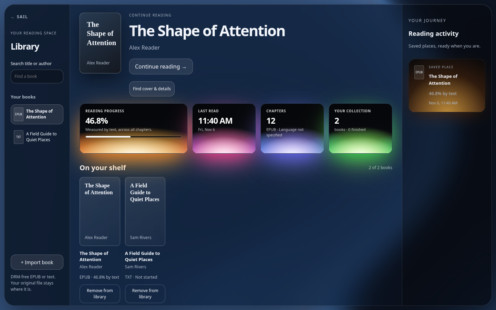
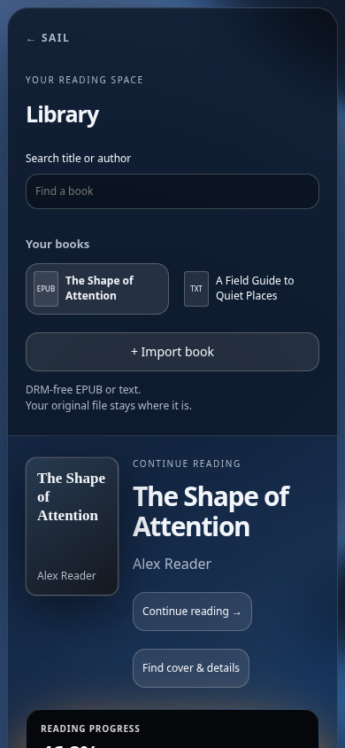
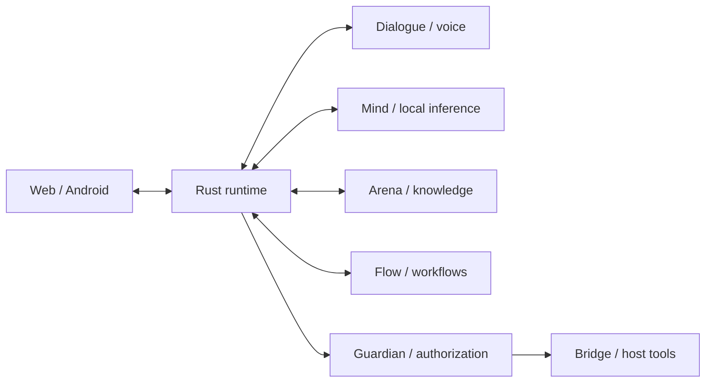

# SAIL

**A local-first AI assistant built around Rust, real tools, and user control.**

SAIL explores how a personal assistant can move beyond conversation: coordinate local inference, retain useful knowledge, run bounded workflows, and present the results in a shared workspace. It combines a Rust backend, a browser interface, and an Android client in one evolving engineering project.

[Usage guide](USAGE.md) · [Architecture & product vision](docs/SAIL_MASTER_VISION.md) · [Technical specifications](docs/README.md) · [Local development](docs/LOCAL_RUNTIME.md)

## Interface

### Desktop library



### Mobile library



These are browser captures of the repository's actual Reader UI using synthetic book titles and reading positions from its isolated Playwright fixture. They demonstrate responsive layout, not a live personal library or proof of backend execution. [Capture provenance](docs/screenshots/README.md).

## Engineering highlights

| Area | What to inspect |
| --- | --- |
| Systems programming | [Rust workspace](Cargo.toml) separating runtime coordination, inference, memory, tools and authorization into crates. |
| Local AI integration | [Mind](crates/sail-mind): model adapters, shared inference budgets, cancellation and supervised local execution. |
| Real-time interaction | [Dialogue](crates/sail-dialogue): voice sessions, streaming, interruption and a browser workspace; local speech workers currently use Python. |
| Security boundaries | [Guardian](crates/sail-guardian) and [Bridge](crates/sail-bridge): capability checks, approvals, tool execution and audit evidence. [Execution architecture](Docs/ARCHITECTURE/Guardian_Execution.md). |
| Stateful workflows | [Flow](crates/sail-flow) and [Arena](crates/sail-arena): workflow execution and knowledge persistence, with subsystem-specific tests. |
| Product implementation | [Web client](crates/sail-dialogue/web), [Android client](android), [design contract](DESIGN.md) and [browser checks](scripts/ui). |

The interesting constraints are deliberate: local ownership of data, limited host resources, cancellation across asynchronous work, permission enforcement outside prompts, and honest reporting of what actually completed.

## How it fits together



This is a simplified orientation map; the [master vision](docs/SAIL_MASTER_VISION.md) defines ownership and the intended architecture in detail.

## Status and scope

SAIL is under active development. This repository contains executable runtime components, workspace interfaces, integrations and tests alongside specifications for a broader assistant. A specification or visible panel does not mean its entire workflow is delivered. The master vision explicitly separates target behavior from implementation; inspect each subsystem and its validation before relying on a capability.

Local inference is the default. The target includes visible, permissioned escalation to external providers; it does not imply that all integrations work offline. The current speech pipeline still uses supervised Python workers, and the shared Rust/Dioxus Web/Android direction remains a migration target.

## Run locally

Start with the [usage guide](USAGE.md) for host requirements, model provisioning, controls and trusted HTTPS. This is a self-hosted development project: it requires local models and speech dependencies, rather than working from a source checkout alone.

```bash
# Install speech dependencies and download the required speech models.
./scripts/voice/setup.sh
# Launch after completing model/host setup in the usage guide.
./run.sh
```

Open **https://localhost:8088**. LAN microphone access requires trusted HTTPS. Model weights, generated certificates and personal runtime data remain local.

## Verification

```bash
cargo test --workspace
cargo xtask assets verify
python3 scripts/check_public_files.py
```

Runtime and voice checks require their documented dependencies; see the [voice protocol](Docs/ARCHITECTURE/Realtime_Voice_Pipeline.md) and [browser fixtures](scripts/ui). These commands describe how to verify the project, not a claim that every test passes on every host.

## Keeping local data private

[Repository privacy guidance](docs/REPOSITORY_PRIVACY.md) explains ignored files, the publication check, and how to stop tracking a local file without deleting it. Credentials, private keys, personal databases, downloaded models and logs do not belong in commits. Screenshot fixtures contain synthetic data only.
