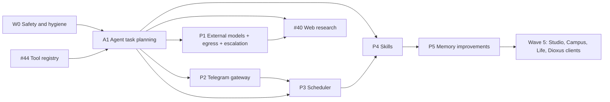

# SAIL engineering roadmap

**As of:** 2026-11-03 (`main` at the merge of #206) · **Owner:** the SAIL owner; coding agents follow it ·
**Inputs:** [Master vision](SAIL_MASTER_VISION.md), [roadmap #15](https://github.com/PedroVictorCoding/SAIL/issues/15),
[external models, gateway, skills and scheduling](SAIL_EXTERNAL_MODELS_GATEWAY_SKILLS.md) (phases P1–P5)

This is the build order for SAIL: what comes next, what each step depends on, and what
could go wrong. It sequences the work; it does not replace each subsystem's spec or
acceptance contract. Revisit it after each wave: update statuses, move items, record why.

## 1. Where SAIL stands

What works end to end today (merged and tested), as opposed to specified:

| Area | Real today | Main gap |
| --- | --- | --- |
| Voice (Dialogue) | Local VAD/STT/TTS chain, barge-in, speak-while-searching, optional on-device speech with measured gate | Speaker identity (#198 open), Android client |
| Mind | One resident local model, GPU offload, voice-first admission on real memory pressure | External providers (P1) |
| Memory (Arena) | Structured knowledge, validated change sets, scoped retrieval, consent, retention, owner views | Core profile block, review queue (P5); #52 conflicts with the memory design |
| Guardian | Grants, approvals, vault, nono/bwrap sandboxes, adversarially tested Forge sandbox | Dedicated runner verified end to end (#43); durable audit CI (#33) |
| Forge | Local solver, sandboxed builds, gates, mutation gate, failure memory, nightly runner, draft PRs, pauses for voice | Issue decomposition (#118), escalation to external models (P1) |
| Continuity | Durable task records, leases, recovery (Forge only) | General consumers: agent plans, scheduled jobs |
| Bridge | Chromium CDP worker with site grants | Web research tool (#40) on top of it |
| Agents | Goal → plan → approve → execute → verify → re-plan, durable across restarts; "Plan: …" by voice or text and a plan card ([design](SAIL_AGENT_PLANNING.md)) | Long-lived approvals, planner quality on the local model, chat and scheduled plans |
| Pulse, Relay, Flow, Skills | Specs; Flow runs one scheduled safety review | Scheduler (P3), gateway (P2), skills (P4) |
| Studio, Campus, Life, Health, Entertainment, Sense, Mesh, Lab | Specs | Later waves |

The largest gap against the vision's north-star test ("ask SAIL to carry forward a
multi-step goal, close the UI, come back to an accurate progress view") is **Agents**.

## 2. Build order

### Wave 0: safety and hygiene (short, first)

| Item | Why now | Done when |
| --- | --- | --- |
| **Review PR #200 (browser host shell) before merging** | It opens an interactive `$SHELL` on the host over `/ws/terminal`, protected by an Origin check. SAIL listens on the LAN. That bypasses Guardian and contradicts the vision's "no unrestricted shell" rule. | Owner authentication on the socket, a Guardian grant, an audit record per session, off by default, loopback-only unless approved; or route through the sandboxed runner |
| Close or narrow stale issues | The backlog should show real work | #42, #95, #96, #117, #185, #186 checked against their acceptance and closed or narrowed; #57 and #61 narrowed to what remains; #52 superseded by the memory design (vision decision 1) |
| Finish #43's verification on the host | Autonomy grows next; its boundary must be proven | The dedicated runner service is provisioned and passes the threat matrix in [the audit](SECURITY_EXECUTION_AUDIT.md) |
| Merge or rebase open PRs | #198 and #205 touch `server.rs` and `resources.rs`, which the next waves touch too | No open PR older than this wave |

### Wave 1: agency (the critical path)

| Item | Scope | Depends on |
| --- | --- | --- |
| **#44 Tool registry** | One typed registry for every tool: schema, owner, Guardian requirement, timeout, cancellation, idempotency, result type. Dialogue's ad-hoc tool list moves onto it. | — |
| **A1 Agent task planning** (#6, #26, #61) | Goal → editable plan → execute steps with tools and approvals → verify each step → re-plan on failure. Durable on Continuity, visible in the existing UI. Design: [Agent task planning](SAIL_AGENT_PLANNING.md). | #44, Continuity |
| **P1 External models** | CLI and API providers, quota ledger, egress guard, escalation. First consumers: Forge and A1's re-planning. | A1 for plan escalation (Forge escalation can land first) |

P1's provider and egress parts do not depend on A1 and can run in parallel. Only
plan-level escalation waits for A1.

### Wave 2: reach

| Item | Scope | Depends on |
| --- | --- | --- |
| **P2 Telegram gateway** (Relay #37) | Pairing, sessions, approvals over chat, voice notes, outbox. Goals from chat become A1 plans. | A1 (so chat can start real work), Guardian approvals |
| **P3 Scheduler** (Pulse #11, #80) | Schedules, event triggers, delivery to chat, quiet hours. A scheduled job runs a prompt, skill, script or plan. | P2 for chat delivery, A1 for scheduled plans, Continuity |

### Wave 3: capability growth

| Item | Scope | Depends on |
| --- | --- | --- |
| **P4 Skills** (#24, #62) | Agent Skills format, index and progressive disclosure, staged self-created skills. A successful plan can be saved as a skill. | #44, A1, P3 (scheduled skills) |
| **#40 Web research** | Search and fetch through Bridge's browser, sourced findings, as a registry tool and plan step. | #44, A1; P1 for escalation |
| **#118 Forge decomposition** | Forge splits "needs-decomposition" issues into sub-issues, using A1's planner. | A1 |
| **P5 Memory** (#21) | Core profile block, review queue, injection scan. | — (independent; scheduled late to limit churn) |

### Wave 4: hardening and operations

#33 durable audit CI · #78 backup verifier · #81 service recovery · #60 benchmark suite ·
#120 coding benchmark · #57 remaining QoS (cgroups) · #58 storage placement remainder.
These can be interleaved as one item per wave, because they protect everything above.

### Wave 5: experiences

Studio #129, Campus (#75, #76), Life constraint solver #103, Dioxus Web/Android clients #38
(vision decision 9: after SAIL is stable and hardened), Health #104/#105, Discovery #10,
Entertainment, Sense, Mesh, Lab. Each builds on A1 plans, P3 schedules and P4 skills.

## 3. Rules for running the plan

- **One vertical slice per PR**, per [§15 of the vision](SAIL_MASTER_VISION.md#15-exact-implementation-workflow-coding-agents-must-follow).
- **At most two waves in flight.** Parallel sessions on `server.rs` and `resources.rs`
  have caused merge conflicts; keep shared files' changes small and land them quickly.
- **Every item names its acceptance test** before coding, and its PR states what was not
  verified.
- **Re-plan at each wave boundary.** Update §1's table and move items with a reason.

## 4. Risks

| Risk | Effect | Mitigation |
| --- | --- | --- |
| New ways in: browser shell (#200), chat gateway (P2), external models (P1) | Each widens who or what can reach SAIL | Default deny, owner authentication, Guardian grants and audit for each; review before merge; the security audit is updated per item |
| Local model too weak for long plans | A1 plans fail or loop | Bounded plans, step verification, re-planning limits; escalation to external models (P1) after measured failure |
| One host, one model, 32 GB | Planner, Forge, voice and schedules compete | Admission on real memory pressure, voice preemption, one heavy job at a time; plans are background work |
| Vendor CLIs change flags and output, or terms | P1 adapters break or become non-compliant | Pin versions, verify per adapter, contract tests against recorded output; providers are opt-in and fail as "unavailable" |
| Redaction misses identifiers | Private data reaches a vendor | Scope and sensitivity rules first, redaction second; receipts; nothing shareable by default |
| Specs outrunning code | Users and agents assume features exist | §1's table is the status of record; specs keep their "not implemented" banners |
| Local test runs blocked by host load | False failures (as with the swap guard) | Admission on memory pressure (#202); CI on clean runners (#205); tests that don't depend on live host load |
| Parallel sessions editing the same files | Conflicts and lost work | Worktrees per task, small PRs, rebase often (§3) |
| Scope creep from the 21-subsystem taxonomy | Nothing finishes | Waves; at most two in flight; Wave 5 waits for A1, P3 and P4 |

## 5. Next three actions

1. Wave 0: security review of #200; close or narrow the stale issues.
2. #44 tool registry, then A1's first slice: a two-step goal with one approval, planned,
   executed, verified and recovered after a restart.
3. P1 Forge escalation in parallel, once the vendor CLIs are installed and signed in on the
   host.
