# Unified SAIL Sandbox Runtime (ADR and P0 foundation)

Status: **Phases 1–2 foundations implemented; not yet wired into Forge or a production
network path.** This document is the authority map and threat model for issue #379. The new
`sail-sandbox` crate provides the typed plan, checked profiles, default-deny network policy and
CONNECT broker core. `sail-runner` now accepts the typed plan on a v2 frame and enforces its
digest and writable roots; Forge, Bridge and credential mediation still need to be migrated.

This is not a claim of Anthropic `srt` parity. The implementation is Rust-native and keeps the
existing Bubblewrap/runner boundary.

## 1. Threat model

Protect:

- the host filesystem and SSH/Cloudflare/Tailscale credentials;
- GitHub, provider and model secrets;
- SAIL source, memory, private Arena/Health/Finance/Obsidian records;
- the owner's home LAN, metadata endpoints and other processes;
- CPU, RAM, disk, descriptors and network capacity.

Adversary:

- a malicious repository or `build.rs`;
- prompt-injected tool or research output;
- a compromised spawned process or plugin;
- forged DNS answers, redirects, CONNECT authorities and grants;
- symlink/race/path escapes and inherited descriptors;
- a cancelled job that tries to outlive its supervisor.

Invariant:

> No untrusted command executes on the host or obtains new rights merely because a model
> requested it. A Guardian-validated, versioned plan flows through one authoritative runner;
> capabilities are checked at use and enforced at the OS boundary. A sandbox or broker failure
> is a denial, never an unconfined fallback.

## 2. Boundary map

```mermaid
flowchart LR
  Model[Model / prompt-injected output] -->|tool request| Agent[Agent / Forge / Bridge]
  Agent -->|requested plan| Guardian[Guardian authority<br/>grant, approval, audit]
  Guardian -->|signed/consumed grant + plan| Supervisor[Trusted supervisor]
  Supervisor --> Runner[sail-runner<br/>dedicated UID, bwrap, cgroups, rlimits]
  Runner -->|no network| Sandbox[Untrusted process<br/>unshared net/pid/ipc/uts]
  Sandbox -->|CONNECT + job binding| Broker[NetworkBroker<br/>Unix socket, default deny]
  Broker -->|validated address only| Internet[Approved destination]
  Broker -.->|revocation| Sandbox
  Guardian -->|grant + policy version| Broker
```



The current implementation adds the `ExecutionPlan`, profile and broker components on the right.
`sail-runner` accepts the plan and enforces its digest and writable roots, but no production
caller sends that frame yet; Forge still uses its own offline Bubblewrap path.

## 3. `ExecutionPlan` (implemented in `crates/sail-sandbox/src/plan.rs`)

```text
ExecutionPlan {
  version, job_id, request_id, principal, capability_grant_id,
  executable { sandbox_path, sha256 },
  argv, cwd,
  read_roots[], write_roots[],
  network: Option<NetworkPolicyRef>,
  credentials[{ handle_id, purpose }],
  limits { wall, cpu, memory, pids, fds, scratch, output, network },
  issued_at_ms, expires_at_ms, audit_correlation_id
}
```

Rules enforced by `ExecutionPlan::validate(now_ms)`:

- version 1, non-nil ids, plan lifetime at most 24 hours, no future issue beyond 5 minutes;
- executable is an absolute sandbox path and a lowercase SHA-256 digest;
- argv and mount counts/bytes are bounded; no NULs;
- sandbox paths are absolute, canonical-looking, and reject `.`/`..`/empty segments;
- read roots cannot include, or broadly contain, `/home`, `/root`, `/etc/ssh`,
  `/etc/gitconfig`, `/etc/docker`, `/etc/apt/auth.conf`, `/run/secrets`,
  `/var/run/secrets` or `/var/lib/sail`; write roots stay under `/work`, `/cache` or
  `/tmp`;
- `cwd` must be inside a declared read or write root;
- credentials are opaque vault handles plus a plain purpose label, never secret material;
- limits are within the runner ceilings;
- a network reference names a bounded policy id and a non-zero version.

A plan is **data, not authorization**. `from_command_plan` exists only for compatibility and
still requires the caller to supply the grant and digest. Deserializing untrusted JSON grants
nothing.

## 4. Checked profiles (implemented in `crates/sail-sandbox/src/policy.rs`)

| Profile | Filesystem | Network | Approval |
| --- | --- | --- | --- |
| `inspect` | system read-only + `/work` read-only | none | no |
| `build_offline` | system read-only, `/work` + `/tmp` write | none | no |
| `fetch_dependencies` | system read-only, `/work`/`/cache`/`/tmp` write | `registry` | no |
| `research_fetch` | system read-only, `/work` + `/tmp` write | `research` | no |
| `coding_networked` | system read-only, `/work` write | `task` | yes |
| `privileged_approved` | explicit only | explicit only | yes |

Profiles are Rust defaults, not YAML interpreted by a model. `ProfilePolicy::validate_plan`
narrows a plan; it never authorizes one. The built-in `registry` policy allows `crates.io`,
`index.crates.io`, `static.crates.io` and strict `*.crates.io` subdomains on 443 only; it is a
starting point for the dependency vertical slice, not a private-registry policy.

## 4a. Runner v2 (implemented in `crates/sail-runner/src/lib.rs`)

The runner accepts two framed protocols on the same dedicated-UID socket:

- v1 `CommandPlan` (legacy command tool, unchanged);
- v2 `{"protocol": "execution-plan-v1", "plan": ExecutionPlan}`.

For v2 the runner:

- validates the plan with the trusted supervisor clock;
- denies plans requesting network (`network: Some`) or credential refs until the broker and
  provider bridge are actually wired — it never silently ignores them;
- verifies the executable is a regular (non-symlink) file inside the trusted rootfs and that
  its SHA-256 equals `executable.sha256`;
- mounts exactly the declared writable roots as per-job tmpfs mounts, collapsing overlapping
  declarations (for example `/work` covers `/work/scratch`);
- runs with `--chdir` set to the plan's sandbox cwd, preserving the existing
  `--unshare-all`/`--disable-userns`/`--cap-drop ALL`/`--clearenv`/cgroup/rlimit boundary,
  and closes every inherited descriptor above stdio with `close_range` before exec;
- returns the same correlated `CommandResult`.

`capability_plan` hashes the full v2 frame, so a changed mount, argv, limit, network ref or
audit correlation changes the Guardian capability. `dispatch_plan`/`dispatch_plan_authorized`
are the trusted adapter entries; no client route exposes them.

Read roots are validated but not narrowed: the runner already exposes the whole trusted rootfs
read-only, and host paths are never mounted. Exact per-root read mounts remain follow-up work.

## 5. Network broker (implemented in `crates/sail-sandbox/src/network.rs` and `proxy.rs`)

Guarantees that are implemented and tested:

- default deny; explicit deny precedence over any allow;
- exact and strict-subdomain patterns, case/trailing-dot normalization, ASCII-only hosts
  (no IDNA/homograph widening in this slice);
- port and protocol match, with allow rules required to state ports;
- literal IP and resolved-IP validation against loopback, private, link-local, CGNAT,
  IETF protocol-assignment, documentation, benchmark, multicast, broadcast, reserved,
  IPv4-mapped, NAT64, 6to4 and Teredo ranges;
- **DNS rebinding resistance**: the resolver is called once, every answer is checked, and the
  proxy must connect to a returned address rather than resolving again;
- monotonic policy versions; an in-flight grant stays on the version it was issued under;
- job-bound 256-bit binding tokens, stored hashed, with an expiry and explicit revocation;
- revocation cancels registered active connections;
- a per-grant DNS query budget;
- CONNECT only, bounded headers, no request pipelining before `200`, peer UID check,
  authenticate-before-resolve, byte ceilings, bandwidth pacing, idle timeout and cancellation;
- no token, URL query or credential is logged.

Explicit non-guarantees (do not claim otherwise):

- **CONNECT is an opaque tunnel.** The broker does not inspect HTTPS paths, methods, headers or
  redirects, and cannot inject provider credentials. Protocol-aware gateway work is separate.
- Plain HTTP proxying (absolute-form requests) and SOCKS5 serving are not implemented; the policy
  schema reserves `socks5` but the proxy rejects anything except CONNECT.
- IDNA/punycode hosts are rejected, not normalized.
- The proxy is not yet mounted into the runner sandbox; Forge still uses its offline
  `--unshare-net` Bubblewrap path.
- The broker is not yet a separate systemd service behind Bridge/Guardian, and there is no
  Guardian inspector, live-status UI, benchmark set or credential mediator in this slice.
- Peer identity is the dedicated runner UID plus the job binding token. A compromised process
  can use its own token for its own policy; it cannot forge another job's token.

## 6. Command and subprocess inventory (production code)

Generated from `Command::new` / `process::Command` call sites outside tests on 2026-11-06.
Counts are call sites, not distinct binaries. The owner is the subsystem whose code contains the
call; the boundary is what isolates it today.

| Owner / file | Sites | Current boundary | Target |
| --- | ---: | --- | --- |
| `sail-runner/src/lib.rs` | 1 | canonical dedicated-UID bwrap runner (`--unshare-all`) | keep; accept `ExecutionPlan` v2 |
| `sail-forge/src/worktree.rs` | 9 | Forge Bubblewrap offline sandbox; host git for worktree/commit | migrate build/test to runner; keep trusted host git explicit |
| `sail-forge/src/model_bench.rs` | 8 | host git/rustc and a built test binary | treat benchmark binaries as untrusted; runner |
| `sail-forge/src/github.rs` | 1 | host `gh`/`git` with owner credentials | provider-operation bridge, no token in process |
| `sail-forge/src/orchestrator.rs` | 2 | host `gh` | provider-operation bridge |
| `sail-forge/src/publish.rs` | 1 | host `git` push | provider-operation bridge / explicit approval |
| `sail-forge/src/reviewer.rs` | 2 | host Codex binary | untrusted runner + explicit model policy |
| `sail-forge/src/eval.rs` | 1 | host `git` | trusted evaluation supervisor |
| `sail-dialogue/src/terminal.rs` | 2 | interactive host shell with a pty | explicit user-authorized terminal boundary; never model-spawned |
| `sail-dialogue/src/vlm.rs` | 4 | host `gh` and `curl` with network/credentials | provider-operation bridge; no raw `curl` for untrusted URLs |
| `sail-dialogue/src/execution.rs` | 0 (uses runner) | canonical runner dispatch | keep; extend with network binding |
| `sail-bridge/src/browser/mod.rs` | 1 | private browser profile, `--no-sandbox` only when isolated | separate trusted fetch boundary; share destination policy, not the browser |
| `sail-mind/src/hardware.rs` | 2 | trusted local hardware probe (`lspci`, llama-server) | trusted internal boundary |
| `sail-mind/src/local.rs` | 2 | trusted llama-server supervisor | trusted internal boundary |
| `sail-mind/src/voice.rs` | 1 | trusted Python voice worker | trusted internal boundary; document inherited env |
| `sail-guardian/src/bin/sail-nono-worker.rs` | 1 | Landlock/nono enforcement worker | optional additive defense, not a substitute |
| `sail-guardian/src/sandbox.rs` | 1 | host command fallback used by legacy callers | remove after runner parity; see §7 |

Total: 39 production call sites. Two additional `Command::new` sites inside
`crates/sail-forge/src/github.rs` are in `#[cfg(test)]` and are excluded.

`tests/` and `*_test.rs` sites are excluded from the production inventory. The full line-level
crosswalk is reproducible with:

```sh
grep -rn "Command::new\|process::Command" crates --include=*.rs | grep -v '/tests/' | grep -v '_test.rs'
```


### Line-level crosswalk

| Call site | Program | Owner | Classification |
| --- | --- | --- | --- |
| `sail-runner/src/lib.rs:170` | `/usr/bin/bwrap` | Runner | canonical boundary |
| `sail-forge/src/worktree.rs:451` | `git` | Forge | trusted host git (clone/rev/checkout) |
| `sail-forge/src/worktree.rs:739` | bwrap | Forge | offline sandbox (second executor) |
| `sail-forge/src/worktree.rs:985` | `git` | Forge | trusted host git |
| `sail-forge/src/worktree.rs:1006` | `git` | Forge | trusted host git |
| `sail-forge/src/worktree.rs:1027` | `git` | Forge | trusted host git |
| `sail-forge/src/worktree.rs:1037` | `git` | Forge | trusted host git |
| `sail-forge/src/worktree.rs:1056` | `git` | Forge | trusted host git |
| `sail-forge/src/worktree.rs:1060` | `git` | Forge | trusted host git |
| `sail-forge/src/worktree.rs:1342` | `git` | Forge | trusted host git |
| `sail-forge/src/model_bench.rs:238` | `rustc` | Forge | benchmark; untrusted binary output |
| `sail-forge/src/model_bench.rs:250` | built test binary | Forge | untrusted; needs runner |
| `sail-forge/src/model_bench.rs:291` | `git` | Forge | trusted host git |
| `sail-forge/src/model_bench.rs:295` | `git` | Forge | trusted host git |
| `sail-forge/src/model_bench.rs:299` | `git` | Forge | trusted host git |
| `sail-forge/src/model_bench.rs:303` | `git` | Forge | trusted host git |
| `sail-forge/src/model_bench.rs:307` | `git` | Forge | trusted host git |
| `sail-forge/src/model_bench.rs:312` | `git` | Forge | trusted host git |
| `sail-forge/src/github.rs:124` | `gh`/`git` | Forge | credential-bearing; bridge target |
| `sail-forge/src/orchestrator.rs:862` | `gh` | Forge | credential-bearing; bridge target |
| `sail-forge/src/orchestrator.rs:1458` | `gh` | Forge | credential-bearing; bridge target |
| `sail-forge/src/publish.rs:31` | `git` | Forge | credential-bearing push; bridge target |
| `sail-forge/src/reviewer.rs:618` | Codex | Forge | untrusted model binary |
| `sail-forge/src/reviewer.rs:699` | Codex | Forge | untrusted model binary |
| `sail-forge/src/eval.rs:245` | `git` | Forge | trusted evaluation supervisor |
| `sail-dialogue/src/terminal.rs:179` | user shell | Dialogue | interactive host shell |
| `sail-dialogue/src/terminal.rs:272` | user shell | Dialogue | interactive host shell |
| `sail-dialogue/src/vlm.rs:821` | `gh` | Dialogue | credential-bearing |
| `sail-dialogue/src/vlm.rs:874` | `gh` | Dialogue | credential-bearing |
| `sail-dialogue/src/vlm.rs:984` | `curl` | Dialogue | raw network; bridge target |
| `sail-dialogue/src/vlm.rs:1071` | `curl` | Dialogue | raw network; bridge target |
| `sail-bridge/src/browser/mod.rs:154` | browser | Bridge | trusted fetch boundary |
| `sail-mind/src/hardware.rs:70` | llama-server | Mind | trusted internal |
| `sail-mind/src/hardware.rs:106` | `lspci` | Mind | trusted telemetry |
| `sail-mind/src/local.rs:330` | llama-server | Mind | trusted internal |
| `sail-mind/src/local.rs:426` | llama-server | Mind | trusted internal |
| `sail-mind/src/voice.rs:79` | `python` | Mind | trusted voice worker |
| `sail-guardian/src/bin/sail-nono-worker.rs:68` | requested program | Guardian | additive enforcement |
| `sail-guardian/src/sandbox.rs:704` | allowlisted binary | Guardian | legacy fallback |

## 7. Known unsafe or unmigrated paths

These are the concrete gaps this epic still owns, in priority order:

1. **Forge build/test** still launches Bubblewrap itself. It is offline and substantial, but it
   is a second executor with its own mounts and limits. Migrate it to the runner after the plan
   gains mounts and cache roots.
2. **Terminal** spawns a host shell with a pty. It is user-initiated, but it is not routed
   through the runner. Keep the interactive exception explicit and never let a model call it
   without a user-authorized session.
3. **Forge/Dialogue GitHub and `curl`** use host credentials/network. They need the
   provider-operation bridge and must not fall back to raw networking.
4. **`sail-guardian/src/sandbox.rs`** still has a legacy host command execution helper. Remove
   it when no caller remains; do not add new callers.
5. **Bridge browser** is a trusted research boundary, not the agent network path. It must keep
   its own profile isolation; sharing the broker policy is fine, sharing the browser is not.
6. **Nono/Landlock** is additive. It must not silently replace a configured mandatory bwrap
   boundary.

## 8. Adversarial test matrix

Implemented in `crates/sail-sandbox/src/{plan,network,policy,proxy}.rs`:

| Area | Covered now |
| --- | --- |
| Plan forgery | expired, future, overlong, bad digest, traversal, forbidden read root, system write root, cwd outside roots, bad limits |
| Policy | default deny, deny precedence, strict subdomain semantics, allow-any rejection, port/protocol match, stale versions |
| Address ranges | loopback, private, link-local, metadata, CGNAT, documentation, multicast, broadcast, IPv4-mapped, NAT64, 6to4, Teredo |
| DNS rebinding | mixed public/private answers denied; connection uses validated addresses |
| Grants | expiry, revocation, unknown token, DNS budget, version pinning |
| Proxy | allowed tunnel, missing/unknown auth, forbidden port, header limits, peer UID requirement (production path) |
| Runner v2 | valid plan reaches the fail-closed UID boundary; network/credential plans denied before spawn; expired plans denied; digest mismatch and symlink executables rejected; overlapping write roots collapsed; capability covers mounts/argv/audit fields |

Still required (from #379 E) before release: real Ubuntu kernel + CI enforcement record, direct
TCP/UDP/raw and inherited-FD attempts inside the actual runner namespace, cgroup fork/reparent
races, broker crash/restart, provider call after revocation, and one positive dependency
download with an independent external listener.

## 9. Rollout

1. **This slice:** typed plan, profiles, network policy, broker core, CONNECT proxy, tests, audit.
2. Add mounts/cache roots and a v2 runner frame; migrate one Forge offline build with parity.
3. Mount a per-job proxy socket into the runner namespace; inject the binding token; add the
   `fetch_dependencies` vertical slice with an external observer test.
4. Guardian-controlled grant lifecycle, live revocation, inspector status/violations.
5. Provider-operation bridge for GitHub/registries; credential refs become enforceable.
6. Full Ubuntu E2E, crash recovery, benchmarks, then remove legacy launcher paths.

Rollback: the offline Forge path remains the default until the networked path passes the
adversarial suite. Unsafe raw execution is never a rollback option.


## 10. Course Factory PDF text operation

Provision **`poppler-utils` inside the administrator-owned runner root image**, including
`/usr/bin/pdfinfo`, `/usr/bin/pdftotext`, their shared libraries and Poppler data/font resources.
Installing these on the daemon host alone does not configure the sandbox. The adapter uses
`SAIL_RUNNER_SOCKET` and `SAIL_RUNNER_UID`; missing configuration returns `None`/`Unavailable`.
No executable override, host path, shell command, password, network or credential is accepted.

`pdf-text-v1` sends a <=64 KiB JSON header followed by exactly `input_bytes` binary bytes.
The header contains the SHA-256 digest, request/correlation ids, and either `page_count` or
`pages {first,last}` (1-based, <=20 pages, <=5,000 physical pages). The service validates the
<=256 MiB declared input before allocation, bounds upload time to 30 seconds, then verifies
both the digest and encryption-name preflight before starting Poppler. Escaped `/Encrypt`
names are refused before Poppler can attempt even empty-password decryption. `pdfinfo`
encryption flags are checked again by the adapter.

The existing dedicated-UID bwrap/cgroup executor supplies the same command limits: 30 seconds
wall time, 10 seconds CPU, 512 MiB RAM, no swap, 32 pids, 64 fds and 32 MiB scratch. PDF stdout
and stderr each stop at 128 KiB; overflow fails the job. The JSON result remains <=2 MiB.
Cancellation/revocation closes the socket and kills the job cgroup. Invalid UTF-8, a page-count
mismatch, parser diagnostics, failure or truncation never becomes indexed text. Document stdout
is data, not diagnostic output, so it is not redacted; parser stderr is replaced with a fixed
message to keep private source text out of receipts.

`learn_pdf::RunnerPdfText::from_env(blob_dir, broker)` implements the shared asynchronous
`PdfTextExtractor`. Guardian authorizes the exact digest and operation. The normal trait path
uses broker policy and waits (`Unavailable`) when approval is required. An approval flow can
retain `prepare(hash, operation)` and pass that exact request plus its token to `run_prepared`
on a blocking worker. It must not recreate the request after approval or bypass the broker.

The pure classic-PDF parser retains its loader guards. Modern PDFs are stored as `Queued`
without fragments and processed by resumable page jobs. Text-only extraction has no bookmarks,
printed page labels or OCR; inferred hierarchy is low-confidence, and empty pages remain
unvalidated placeholders. The ignored Rust Book host probe is a bounded, counts-only
compatibility check, **not evidence of a deployed runner sandbox**. Verify the dedicated UID,
root image, cancellation, limits and socket round trip on the deployment host before release.
