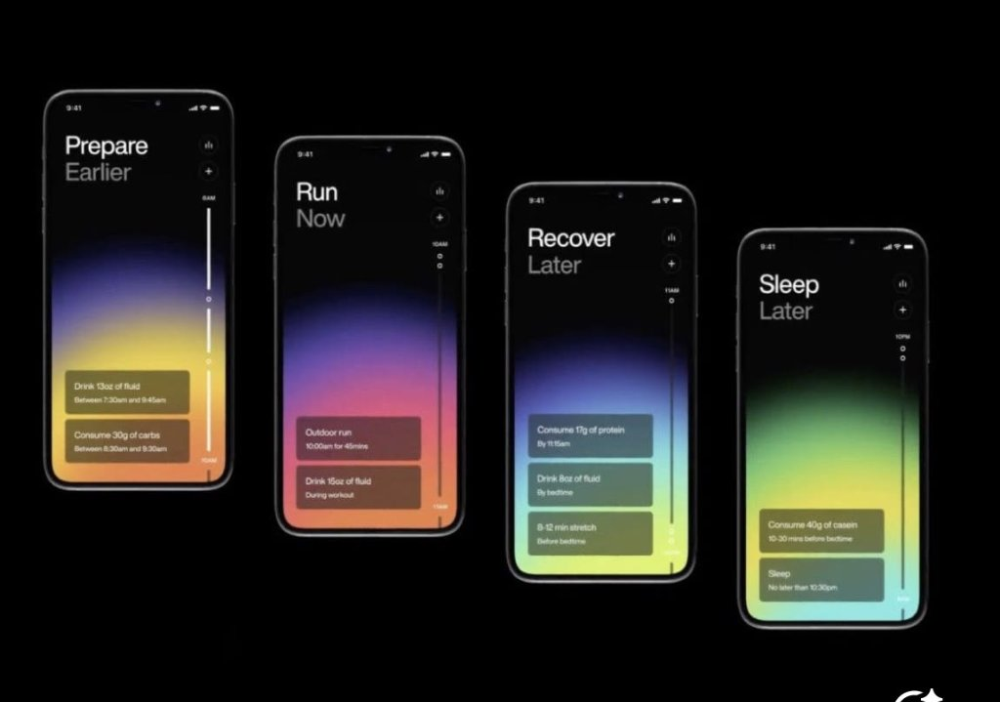
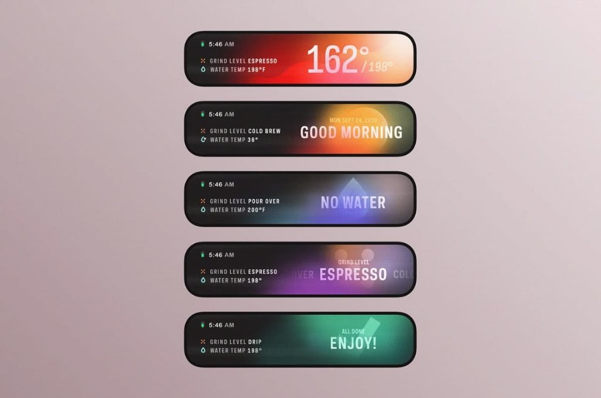
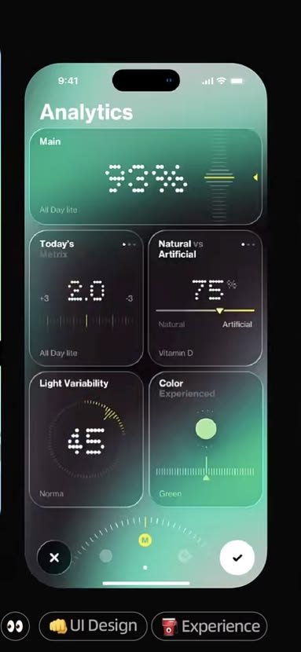
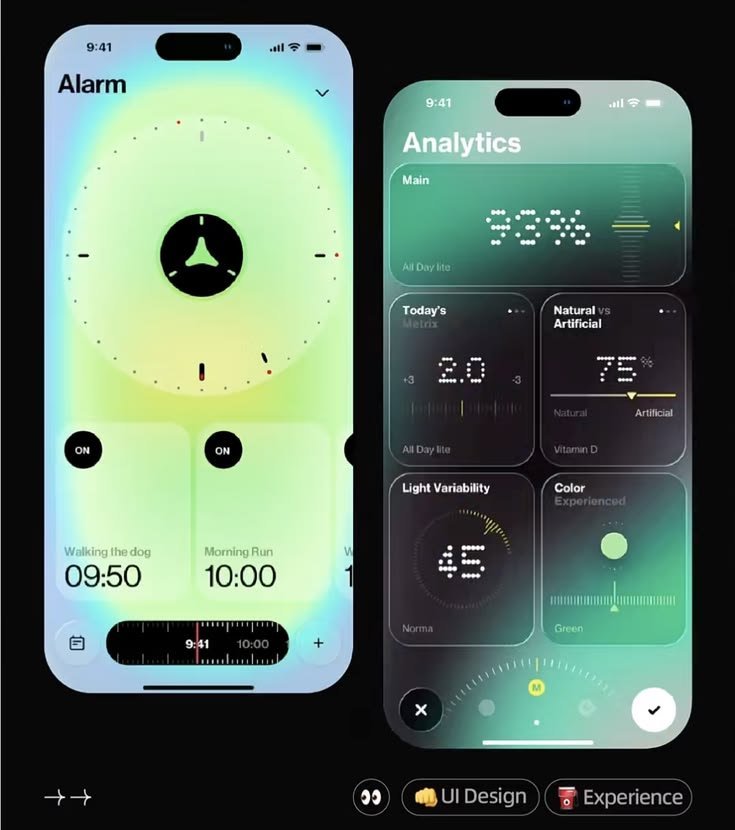
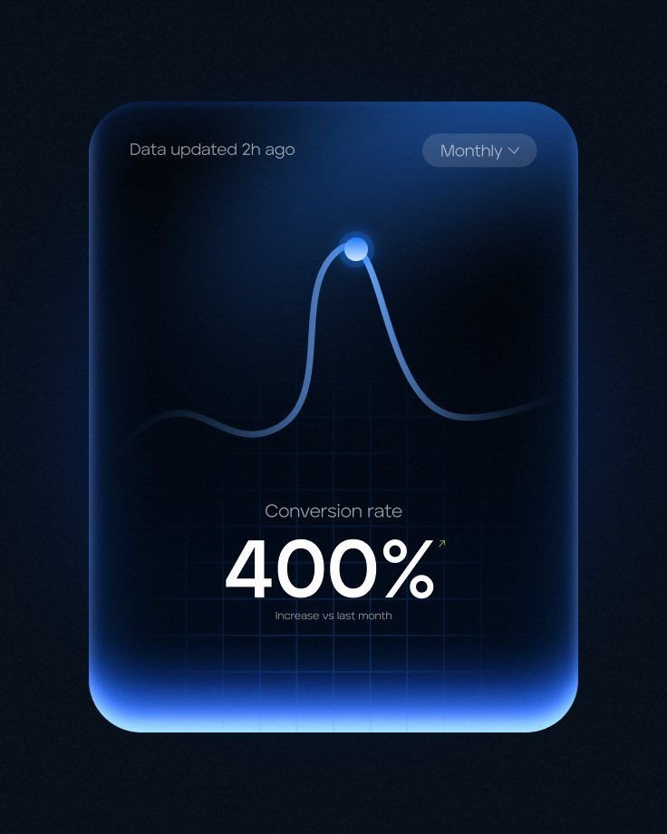
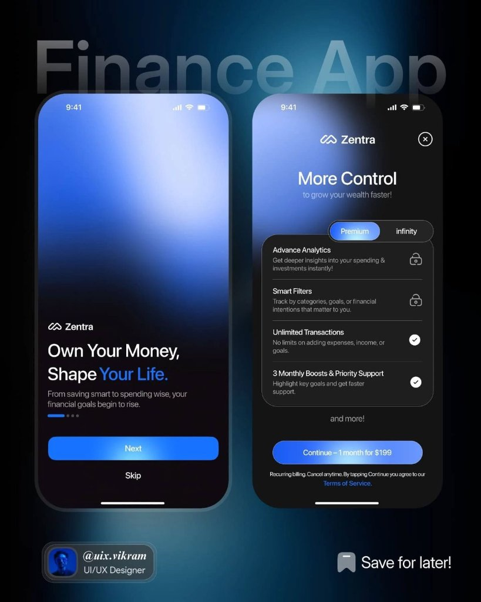

# Owner-provided visual references — Ambient Glass UI

**Reference set:** eight image uploads provided in ChatGPT conversation on 2026-11-06. These are *references*, not runtime assets and not a grant to copy third-party branded visuals. Production implementation must follow [DESIGN.md](../../DESIGN.md).

The eight images belong in `docs/design/references/ambient-glass/` with filenames below. Owner-supplied reference assets are stored in `docs/design/references/ambient-glass/`.

| Filename | Reference Image | Contents to interpret | Intended SAIL application |
| --- | --- | --- | --- |
| `01-day-phase-timeline.png` |  | Four tall black phone screens, chromatic gradient light at bottom, schedule timeline | Life / Pulse day phases, structured actionable tasks, quiet ambient time |
| `02-luminous-feature-panels.png` | *(Inspiration concept)* | Four sparse black cards with bright bottom glow and minimal text | Feature onboarding, one important active insight per card |
| `03-progress-project-cards.png` | *(Inspiration concept)* | Dark projects with small tint, progress bars, remaining-time chips | Forge / Continuity tasks and verifiable progress; no fabricated percentages |
| `04-device-status-capsules.png` |  | Compact horizontal light-filled hardware status strips | Orb state, recording/playback/connection indicators |
| `05-dotted-measurement-tiles.png` |  | Black dotted measurement UI, colorful panels, circular indicators | Health readings + Arena Learn progress, real provenance, not bogus clinical values |
| `06-gradient-alarm-analytics.png` |  | Light mint/green gradient alarm, glassy dark analytics cards | Wake/alarm/shortcuts, responsive time ruler; low clutter |
| `07-saturated-blue-analytics-glow.png` |  | Deep blue analytical panel with soft bloom, large center metric | Finance/Lab verifiable featured metric, not pervasive decoration |
| `08-immersive-gradient-onboarding.png` |  | Rich blue/black gradient mobile intro and offer screen | Compositional lighting/onboarding only; **do not copy paid offer/UI or brand** |

## Coder instructions
- Compare all 8 references by concept, not literal copy. The common design cues are: **dark broad negative space, low-density text, blurred colored light behind/within a component, rounded glass, minimal iconography and restrained motion**.
- The owner's desired SAIL result is **one unified state-reactive system**. Do not implement eight competing themes, hardcoded full-page rainbow backgrounds or asset-heavy UI.
- For legibility, see `DESIGN.md` and the WCAG requirements; do not sample exact body text/metric designs from screenshots.
- Use images only inside development docs; do not include them in shipped application bundles or public screenshots without rights review.
